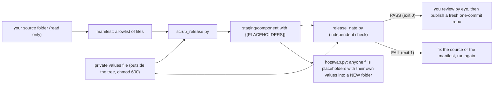

# release-kit

Turn a folder of your own files into a copy that is safe to publish, check that nothing private is left, and let anyone fill the placeholders with their own values again.

   

**Status:** prototype with its own tests | **Tested on:** macOS, Python 3.9 (Linux written, not verified) | **Last test run:** 2026-11-21

> **A PASS means nothing known was found, not that the tree is safe.** The gate looks for the values and shapes you told it about, plus common disguises of them. It cannot know what you did not list. Read the staged tree yourself before you publish. See [Limits and status](#limits-and-status).

## Why it exists

Publishing a private project by accident (a hostname, a home path, a token, a real name) is easy and hard to undo. This kit replaces private values with `{{PLACEHOLDERS}}`, then runs a second, independent check that recomputes everything from your private values file and fails if anything could still ship.

## How it works



`release.py` runs scrub, annotations, syntax check, gate, shell leak check and a fresh one-commit git repo in one command. Nothing is ever pushed anywhere and nothing uses the network.

## Quick start

Needs Python 3.9+ and nothing else. The kit folder is this repository root. Every command below was run as written in a fresh clone on 2026-11-21 (macOS, Python 3.9.6); outputs are pasted from that run.

```bash
git clone https://github.com/Ethan-da-Tech-Wizard/release-kit && cd release-kit

# 0. folders and a values file (the example file has fake values; put YOUR values in it later)
mkdir -p ~/release_work/_privacy ~/.config/twu_release
chmod 700 ~/.config/twu_release
cp examples/EXCLUDE_LIST.txt ~/release_work/_privacy/EXCLUDE_LIST.txt
cp examples/example_values.json ~/.config/twu_release/values.private.json
chmod 600 ~/.config/twu_release/values.private.json
# the salt in the example file is public and the tools refuse it: write your own random one
python3 -c "import json,os,secrets;p=os.path.expanduser('~/.config/twu_release/values.private.json');d=json.load(open(p));d['salt']=secrets.token_hex(16);json.dump(d,open(p,'w'),indent=2)"

# 1. scrub the demo project into ~/release_work/staging/demo/
python3 scrub_release.py --manifest examples/example_manifest.json \
    --release-root ~/release_work --source-root examples/demo_project
# component=demo copied=2 refused=0 replacements=7
#   EMAIL: 1
#   EXACT: 5
#   HOME_PATH: 1

# 2. gate: scan the staged tree
python3 release_gate.py --release-root ~/release_work
# release_gate: scanned 6 files; findings=0
# release_gate: PASS

# 3. hot-swap: fill the placeholders with someone's own values into a NEW folder
echo '{"OWNER_NAME": "Pat Example", "OWNER_HANDLE": "pexample", "HOST_1": "mybox", "HOME_DIR_1": "/Users/pat", "EMAIL_1": "pat@mail.example"}' > ~/my_values.json
chmod 600 ~/my_values.json
python3 hotswap.py --release-root ~/release_work --component-dir ~/release_work/staging/demo \
    --values ~/my_values.json --out ~/my_copy/demo
# files=2 changed=2 replacements=7 unresolved_tokens=0
#   resolved EMAIL_1 x1 ... (one line per placeholder)
```

Network: no. Root: no. Writes outside the clone: only the folders above (`~/release_work`, `~/.config/twu_release`, `~/my_values.json`, `~/my_copy`); delete them to undo. Never reads your real files unless you point `--source-root` at them. Use `python3 release.py ...` for the one-command version (see [docs/REFERENCE.md](docs/REFERENCE.md#quick-start-copy-and-paste)).

## What is in the box

| File | What it does |
|---|---|
| `scrub_release.py` | copies an allow-listed set of files into `<release root>/staging/<component>/`, replacing private values with placeholders |
| `release_gate.py` | independent verifier: scans `staging/`, exit 1 if anything private could ship (an empty tree also fails) |
| `hotswap.py` | fills a component's placeholders with your values into a NEW folder (never overwrites) |
| `reannotate.py` | rebuilds the annotation pages (`ANNOTATIONS.md/json`, `PLACEHOLDERS_INDEX.md`) after hand edits |
| `release.py` | one command: scrub, annotate, syntax check, gate, shell leak check, fresh one-commit git repo |
| `hermetic_run.py` | runs a test command in layered isolation and writes an honest receipt ([HERMETIC_RUN.md](HERMETIC_RUN.md)) |
| `allowlist.py`, `normalize.py`, `syntax_check.py` | helpers used by the tools above |
| `templates/check_placeholders.sh` | the shell leak check run by `release.py` |
| `examples/` | neutral exclude list, manifest, values, allowlist and a tiny demo project, all with made-up values |

## Configuration reference

There are no config files you must edit; behaviour comes from flags, three input files and a few environment variables. Full detail and every limit: [docs/REFERENCE.md](docs/REFERENCE.md).

### Environment variables

| Variable | Used by | Default | Meaning |
|---|---|---|---|
| `RELEASE_SOURCE_ROOT` | `scrub_release.py`, `release.py` | current directory | default for `--source-root` (always pass the flag instead) |
| `CHECK_PLACEHOLDERS_EXTRA_REGEX` | `templates/check_placeholders.sh` | unset (no extra rule) | extra extended regex; any match fails ("custom private pattern") |
| `CHECK_PLACEHOLDERS_IGNORE_FILE` | `templates/check_placeholders.sh` | unset | file of fixed strings, one per line; a hit whose line contains one is ignored |
| `CHECK_PLACEHOLDERS_OVERCLAIM` | `templates/check_placeholders.sh` | `0` | set to `1` to also fail on marketing words such as "battle-tested" |

### Flags

| Flag | Tools | Default | Meaning |
|---|---|---|---|
| `--manifest FILE` | `scrub_release.py`, `release.py` (repeatable) | required | JSON allowlist of files to publish, relative to the source root |
| `--values FILE` / `--rules FILE` | scrub, gate, hotswap, reannotate / `release.py` | `~/.config/twu_release/values.private.json` (`--rules` is required) | your private values file; must be outside the release root, owned by you, mode 600 |
| `--release-root DIR` | all but `hermetic_run.py` | scrub/gate/hotswap/reannotate: the parent of the kit folder; `release.py`: the parent of the kit folder | folder holding `_privacy/EXCLUDE_LIST.txt` and `staging/` |
| `--source-root DIR` | scrub, `release.py` | `$RELEASE_SOURCE_ROOT`, else current directory | folder the manifest paths are relative to (only read) |
| `--restore-map FILE` | scrub, `release.py` | `~/.config/twu_release/restore.private.json` | where pattern-token originals are saved (mode 600, outside the tree) |
| `--staging DIR` | gate, reannotate | `<release root>/staging` | folder to scan |
| `--out DIR` | `release.py`, `hotswap.py` | required | output folder; must be new or empty |
| `--allow-email ADDR` | gate | none | email that may appear (repeatable) |
| `--allowlist FILE` | gate, `release.py` | none | JSON of fake-secret fixtures, approved binaries, syntax-exempt paths; each needs a `reason` ([examples/example_allowlist.json](examples/example_allowlist.json)) |
| `--neutral-author VALUE` | gate, `release.py` | none | metadata value that identifies nobody (repeatable) |
| `--component-dir DIR` | `hotswap.py` | required | staged component to fill |
| `--restore FILE`, `--private-annotations DIR` | `hotswap.py` | next to the default restore map | pattern-token originals and the salted-hash annotations |
| `--dry-run` | `hotswap.py` | off | show counts, write nothing |
| `--allow-partial` | `hotswap.py` | off | allow unresolved `{{TOKEN}}`s |
| `--meanings FILE` | `reannotate.py` | none | extra plain-language meanings for placeholders |
| `--allow-refused` | `release.py` | off | do not fail the scrub step when files were refused |
| `--no-git` | `release.py` | off | skip the one-commit git step |
| `--git-name`, `--git-email`, `--git-date` | `release.py` | `Release Author`, `release@example.invalid`, `2000-01-01T00:00:00+0000` | neutral identity and fixed date for the output commit |
| `--placeholders-script FILE` | `release.py` 
| `--src DIR`, `--out FILE`, `--timeout S`, `--pass-env NAME`, `--require-os`, `--soft-only`, `--allow-loopback`, `--allow-zero-tests`, `--json`, `--no-tail` | `hermetic_run.py` | see [HERMETIC_RUN.md](HERMETIC_RUN.md) | isolation and receipt options |

Optional keys inside the values file: `gate_ignore_words`, `gate_public_phrases`, `gate_public_identity`, `gate_allow_strings`, `rename_prefixes` (all explained in [docs/REFERENCE.md](docs/REFERENCE.md)). Run any tool with `--help` for its exact flags.

## Tests

| Field | Value |
|---|---|
| Result | 236 tests, 0 failures, 0 skipped (plain run); 3 of 3 hermetic runs also passed |
| Command | `python3 -B -m unittest discover -s tests` from the repository root |
| Hermetic run | `python3 hermetic_run.py --soft-only --src . -- python3 -B -m unittest discover -s tests` (label `SOFT`: the kit's own sandbox-canary tests cannot run inside an OS sandbox, so the OS layers are off for this suite; with them on, 1 test errors for that reason, and it did so before this change too) |
| Environment | macOS, Python 3.9.6, fresh clone |
| Date | 2026-11-21 |

These are this repository's own tests, written with AI agents under my direction and checked by me. They show the code does what I expected; they are not an independent audit and not a coverage claim. GitHub Actions runs the same suite on Ubuntu and macOS with Python 3.9 and 3.12 (workflow in `.github/workflows/tests.yml`); I have not yet seen that workflow run on GitHub, so no CI result is claimed here.

## How it was built

I am the programmer: I design, specify and direct AI coding agents that generate much of the code, and I review and test everything. Ethan Kilmer, TWU LLC. Commits that an agent contributed to carry a `Co-Authored-By` trailer. A per-function authorship split is not recoverable.

## Limits and status

- Prototype. Regex and rule based; a PASS means "nothing known was found".
- macOS and Linux only; **Windows is not supported**. Tested on macOS with Python 3.9. The Linux paths (including the `bwrap` / `unshare` isolation in `hermetic_run.py`) are written but not verified.
- Prose that identifies you by context, images, PDFs, archives, binaries and git history are out of scope; the full list of evasions the gate does not see is in [docs/REFERENCE.md](docs/REFERENCE.md#threat-model-and-honest-limits).
- Scrub deletes and rebuilds `staging/<component>/` on every run; hand edits there are lost.
- Python 3.12 is exercised by the CI workflow only; I have not run the suite on 3.12 by hand.

## Contributing, security, conduct

[CONTRIBUTING.md](CONTRIBUTING.md) | [SECURITY.md](SECURITY.md) | [CODE_OF_CONDUCT.md](CODE_OF_CONDUCT.md) | [CHANGELOG.md](CHANGELOG.md)

## Related repositories

- [agent-guardrails](https://github.com/Ethan-da-Tech-Wizard/agent-guardrails): STOP latch, write guards and secret-scan hooks for AI-agent workflows. It was released with this kit's scrub and gate.

## Contact and licence

ethan@twu.software | https://twu.software | MIT, copyright TWU LLC (see [LICENSE](LICENSE)).
